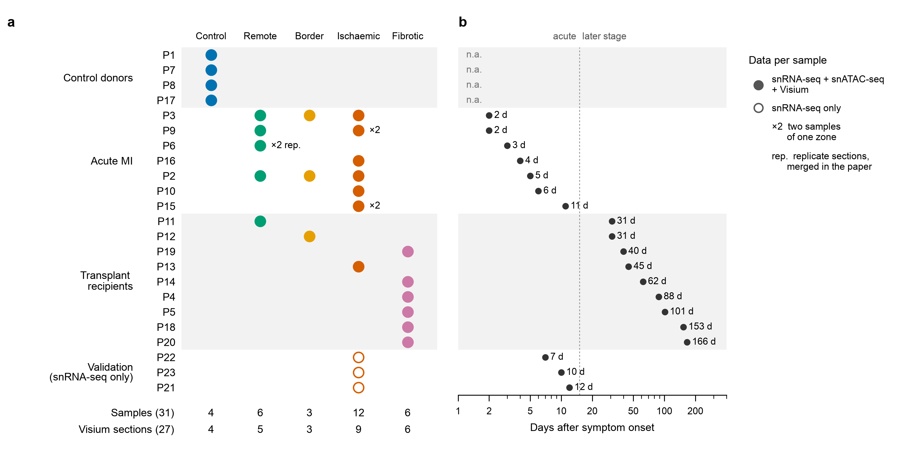

# Kuppe et al. 2022 cohort



**Kuppe et al. 2022 cohort.** **a**, Samples contributed by each of 23 patients (rows) across five myocardial zones. Filled markers: matched snRNA-seq, snATAC-seq and Visium; open markers: snRNA-seq only (external validation). ×2, two samples of one zone; rep., replicate sections of one sample, merged in the paper. Bottom: samples per zone (31) and Visium sections per zone (27, replicates counted once). **b**, Time from symptom onset to sampling. Dashed line, 15 days. n.a., control donors. Data from Kuppe et al., Nature 608, 766–777 (2022), Supplementary Table 1.

## Files

| File | Content |
|---|---|
| `kuppe_cohort.pdf` | Vector figure, 183 × 96 mm, Arial 5.5–8 pt (Nature format) |
| `kuppe_cohort.png` | Same figure at 450 dpi, for slides |
| `cohort_table.csv` | One row per sample: patient, zone, patient group, disease, age, sex, days after onset, data types, Visium runs and depth |

## Numbers, checked against the paper

- **Patients:** 23 = 4 control donors + 19 patients (7 acute MI, 9 transplant recipients, 3 validation-only).
  - "Transplant recipient" is inferred from the disease column of Supplementary Table 1 (ICM, or CAD/HF for P5), which has no transplant column. It gives exactly the paper's nine later-stage specimens.
  - The paper calls these nine "(fibrotic zone)", but three of them are not fibrotic: P11 (remote), P12 (border) and P13 (ischaemic).
- **Samples:** 31. Per zone: control 4, remote 6, border 3, ischaemic 12, fibrotic 6. This matches the paper's Fig. 1a.
- **Visium: 28 runs load. They give 27 sections, matching the paper's n = 27.**
  - Only P6's remote zone is a replicate: one sample ID (RZ_P6), two runs (ACH0021, ACH0022), and one Zenodo h5ad. Counting it once gives 28 − 1 = 27, with per zone 4 / 5 / 3 / 9 / 6.
  - The other two ×2 pairs are separate samples with their own IDs, runs and h5ad files: P9 (GT/IZ_P9 and GT/IZ_P9_rep2, despite the name) and P15 (GT/IZ_P15 and IZ_P15).
- **Smaller sample sets in some figure legends** (3 / 4 / 4 / 5 / 9 = 25) come from analyses that need both snRNA-seq and snATAC-seq. They are subsets, not contradictions.
- **Per-sample zones and days come from Supplementary Table 1.**
  - All 31 rows were cross-checked against the three Zenodo sample sheets (Visium, snRNA-seq, snATAC-seq), with no mismatches in patient or zone.
  - Days are given only in Supplementary Table 1.
- **The paper's Fig. 1b has two label slips.** Its triangles (zone and day) agree with Supplementary Table 1, but:
  - "P3" appears four times at day 2, while P3 has three samples. The fourth is P9's remote-zone sample (RZ_P9), which has no label of its own.
  - "P11" appears twice at day 31, and P12 is missing. The orange border-zone triangle is P12 (RZ/BZ_P12).
- **"Filled" markers** (all three data types) come from the authors' sample sheets. They have not yet been checked against the single-nucleus objects.

## How to rebuild

From `Derived_Modalities/`:

```
python 01_data_preprocess/kuppe_cohort/cohort_figure.py data/kuppe_2022 results/kuppe_2022/cohort
```

The script needs the Kuppe metadata sheets (`downloads/kuppe_2022.py --sets metadata visium_raw`) and Supplementary Table 1. The table is not on Zenodo; the download link is in the script's docstring. Visium depth columns are filled only if the Visium exploration (`01_data_preprocess/kuppe_visium_exploration/run_all.sh`) has been run.
