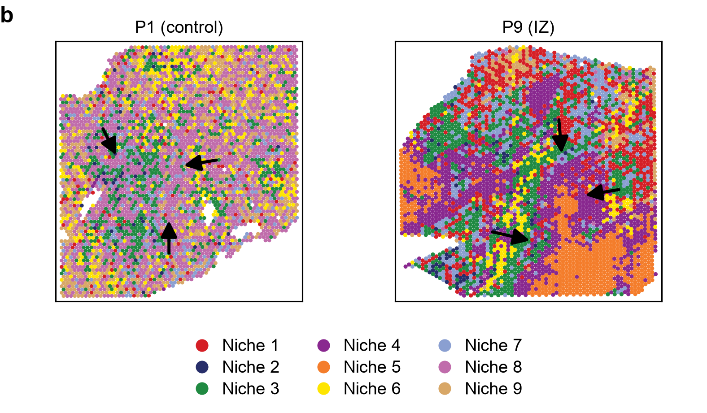

# Kuppe et al. 2022, Fig. 2b: reproduction



**Mapping of cell-type niches in a control and an ischaemic-zone sample** (reproduction of Kuppe et al., Nature 608, 766–777 (2022), Fig. 2b). Each dot is a Visium spot, coloured by the authors' cell-type niche. Arrows show niche 8 (left) and niche 4 (right). Cell-type niches were defined by the authors by clustering cell2location cell-type proportions; they do not use spot coordinates.

## What was reproduced, and from what

| Element | Source | How it was checked |
|---|---|---|
| Niche label per spot | `celltype_niche` in the authors' Seurat objects (Zenodo 6580069) | Shipped, not recomputed |
| Spot positions | Same Seurat objects (full-resolution image coordinates) | Shipped |
| Left slide: P1 (control) | `control_P1`, Visium run `10X001` | Tissue outline and holes match the published panel |
| Right slide: P9 (IZ) | `GT/IZ_P9_rep2`, Visium run **`ACH0013`** | Matched by shape: notch at the lower left, niche-5 block at the lower right. The other P9 ischaemic section (`GT/IZ_P9`, `ACH0012`) does not match. |
| Niche numbering | `ctniche_1`…`ctniche_9` = paper's niche 1–9 | Median composition per niche agrees with the paper's description of Fig. 2c (see below) |
| Colours | Authors' niche colours | Copied from `saezlab/visium_heart`, `st_snRNAseq/05.1_nicheanalysis/plot_niche_example.R` |
| Arrows | Positions transcribed from the published panel | Each tip is moved to the nearest spot of the named niche, so the arrows point at niche 8 (P1) and niche 4 (P9) |

**Niche numbering check.** The cell types with the highest scaled median proportion in each niche, across all 91,517 spots:

| Niche | Top cell types | Paper's description |
|---|---|---|
| 1 | PC, Endo, CM | Myogenic niche |
| 2 | Adipo, Neuronal, prolif | Rare cell types: adipocytes, lymphoid, cycling |
| 3 | vSMCs, … | vSMC niche |
| 4 | Fib, Myeloid, Mast | Fibrotic niche |
| 5 | Myeloid, Mast, Lymphoid | Inflammatory niche |
| 6 | vSMCs, CM, Fib | vSMC niche |
| 7 | PC, Endo, Neuronal | Myogenic niche |
| 8 | CM, Endo, PC | Myogenic niche |
| 9 | CM, Endo, PC | Myogenic niche |

## Differences from the published panel

- **Spots and frames:** spot size and frame padding are matched by eye. The paper used Seurat's `SpatialDimPlot`; here each spot is drawn at 105 % of the spot spacing.
- **Arrows:** positions are approximate; their targets are exact (see above).
- **Panel size:** 89 mm wide, Arial 6 pt, panel letter 8 pt (Nature single column). The published panel is part of a larger figure.

A side-by-side comparison with the published panel was made for checking. It is not included here, because the paper is under exclusive licence to Springer Nature.

## Niche shares on the two slides

From `fig2b_summary.json`:

- **P1:** niche 8 covers 44 % of spots, as expected for an evenly distributed myogenic niche on a control slide.
- **P9:** niche 4 covers 24 % and niche 5 covers 14 %, the "distinct regions" described in the paper's text.

## How to rebuild

From `Derived_Modalities/`, after `01_data_preprocess/kuppe_visium_exploration/run_all.sh` has extracted the Seurat tables:

```
python 01_data_preprocess/kuppe_fig2/fig2b.py data/kuppe_2022 results/kuppe_2022/fig2b
```
